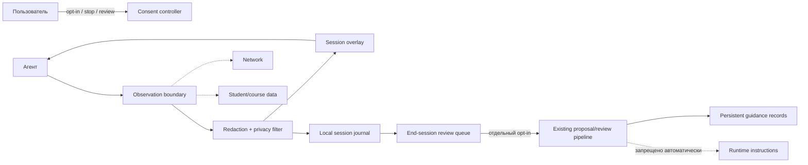

# Дизайн стадии 2: интерактивное самоулучшение пользовательской сессии

**Статус:** проектная спецификация; реализация не считается начатой.

**Дата:** 18 октября 2026.

**Связанные документы:**

- [self-improvement-design.md](self-improvement-design.md) — текущий локальный журнал, human-reviewed proposals и ограничения MVP;
- [self-improvement.md](self-improvement.md) — существующий CLI workflow.

## 1. Цель и границы

Новая стадия должна позволить агенту во время активной пользовательской сессии:

1. в начале сессии предложить пользователю включить интерактивное улучшение опыта;
2. при согласии собирать только минимальные наблюдения о работе обвязки и качестве взаимодействия;
3. немедленно применять безопасные, обратимые улучшения **только в текущей сессии**;
4. в конце сессии показать накопленные наблюдения, изменения и кандидатов на сохранение;
5. сохранять изменения для будущих сессий только после отдельного явного подтверждения пользователя и существующего human-review workflow.

Это не обучение модели, не скрытый transcript hook, не автоматическое изменение политики помощи и не автоматическое сохранение пользовательских предпочтений в общую память.

### 1.1. Нормативное правило

Согласие на realtime session improvement означает только разрешение на работу в рамках текущей сессии. Оно **не** означает согласие на:

- запись полного диалога;
- сохранение персональных данных, учебного прогресса или graded work;
- передачу данных по сети;
- изменение `AGENTS.md`, policy, consent-gate, кода или активных системных инструкций;
- promotion в persistent guidance;
- автоматическую отправку отчётов или commit/push.

Каждое расширение области требует отдельного opt-in и отдельного threat model.

## 2. User experience и consent flow

### 2.1. Начало сессии

До первого сбора session-improvement observation агент показывает короткий запрос:

> Хотите включить интерактивное улучшение этой сессии? Агент будет сохранять только короткие технические наблюдения о работе botai, не будет записывать полный диалог или учебные данные. Изменения сначала действуют только в этой сессии. Сохранение на будущее потребует отдельного подтверждения. Варианты: `yes`, `no`, `details`.

Правила:

- отсутствие ответа, неизвестный ответ или неинтерактивный канал равны `no`;
- `details` показывает scope, категории данных, срок хранения и команды отключения;
- `yes` фиксируется как session consent с timestamp, scope и способом получения;
- consent не наследуется между сессиями по умолчанию;
- пользователь может выполнить `disable`/`stop` в любой момент;
- изменение consent не должно требовать перезапуска сессии.

### 2.2. Два независимых разрешения

| Разрешение | Действует | Что позволяет | Чего не позволяет |
|---|---|---|---|
| `session-opt-in` | текущая сессия | минимальные observations, session overlay, realtime review | persistence, network, policy/code mutation |
| `persistent-opt-in` | конкретная запись/кандидат | сохранить выбранную запись через review/promotion | автоматическую активацию, публикацию, изменение protected files |

Нельзя трактовать одно подтверждение как другое.

### 2.3. Завершение сессии

Перед закрытием сессии агент показывает:

- количество observations;
- какие session-only изменения были включены;
- какие observations отброшены redaction/privacy filter;
- список кандидатов на сохранение с кратким rationale;
- для каждого кандидата варианты `save`, `discard`, `inspect`, `later`.

По умолчанию — `discard` для session-only overlay и неподтверждённых observations. Если пользователь не ответил, ничего не сохраняется.

## 3. Архитектура



### 3.1. Компоненты

#### Consent controller

Хранит только состояние согласия текущей сессии:

```json
{
  "session_id": "opaque-random-id",
  "state": "enabled|disabled|expired",
  "scope": ["session_observation", "session_overlay"],
  "created_at": "UTC timestamp",
  "source": "interactive_tty|interactive_ui",
  "expires_at": "session end",
  "persistent_opt_in": false
}
```

`session_id` не должен быть идентификатором пользователя или ученика. Consent state не попадает в persistent guidance без отдельного audit event.

#### Observation boundary

Единственная точка, через которую session-improvement получает данные. Она принимает структурированные события, а не произвольный transcript:

- `tool_error`: код/категория ошибки и безопасная ссылка на локальный компонент;
- `workflow_friction`: короткое описание повторяющегося неудобства;
- `ui_or_cli_gap`: отсутствующая или неясная команда/подсказка;
- `successful_correction`: факт исправления локальной обвязки без содержания задания;
- `session_preference`: только session-scoped preference, не persistent memory.

Запрещены: raw prompt, raw response, полные tool outputs, student answers, course text, credentials, personal data и произвольные пользовательские цитаты.

#### Redaction/privacy filter

До записи событие проходит:

1. schema validation и size limits;
2. secret redaction;
3. запрет потенциальных учебных/персональных данных по полям и source policy;
4. canonical path validation;
5. проверку, что событие не содержит transcript-like payload;
6. отказ целиком при сомнении — не best-effort сохранение.

Redaction не является доказательством обезличивания. Поэтому denylist недостаточен без allowlist полей.

#### Session overlay

Overlay — временный слой узких настроек для текущей сессии. Он:

- хранится отдельно от persistent guidance;
- имеет TTL до конца сессии;
- не изменяет `AGENTS.md`, policy, skills, code или consent rules;
- может менять только presentation/workflow hints из заранее разрешённого allowlist;
- имеет before/after snapshot и мгновенный `undo`;
- не используется после завершения сессии без отдельного proposal.

Примеры допустимых overlay: показать более подробную подсказку о команде, повторить формат ответа, временно включить диагностический уровень интерфейса. Недопустимы: ослабить правила помощи, скрыть предупреждение, изменить security gate или автоматически переписать system prompt.

#### Existing persistent pipeline

Сохранение на будущее выполняется только через уже существующий pipeline:

`observation → review → proposal → structural verify → TTY approve → apply → optional promotion`.

Realtime loop не получает права напрямую вызывать `approve`, `apply`, `promote`, push или network API.

## 4. Realtime loop

### 4.1. Фазы

1. **Idle:** запросить opt-in; ничего не собирать до ответа.
2. **Observe:** принимать только allowlisted structured events.
3. **Filter:** redaction, policy and privacy checks.
4. **Classify:** определить `session_only`, `candidate_for_review` или `discarded`.
5. **Overlay preview:** показать пользователю предполагаемое session-only изменение.
6. **Apply session overlay:** применить только после подтверждения, если изменение не является purely informational.
7. **Checkpoint:** периодически показывать краткий счётчик и давать `stop`, `undo`, `inspect`.
8. **Close:** собрать end-session summary и запросить отдельное persistent opt-in.

### 4.2. Ограничения realtime

- Debounce и rate limit: не более одного observation на тип/область за заданный интервал.
- Размер события и суммарный бюджет сессии ограничены.
- Нет фонового вызова модели для «анализа» всей сессии.
- Нет скрытых файловых записей до opt-in.
- Ошибка фильтра отключает сохранение конкретного события, но не должна ломать пользовательскую сессию.
- Два последовательных отказа фильтра переводят session improvement в `disabled` до конца сессии.
- Overlay никогда не расширяет allowlist сам.

## 5. Persistent save workflow

После end-session summary пользователь выбирает конкретный candidate:

1. агент показывает canonical summary без transcript;
2. пользователь запрашивает `inspect`, чтобы увидеть все поля, source refs и ограничения;
3. система создаёт обычную локальную запись `capture`;
4. человек отдельно выполняет review с evidence и `expected_version`;
5. proposal создаётся только для разрешённого Markdown guidance;
6. apply/promotion остаются отдельными TTY-confirmed действиями;
7. если пользователь выбирает `discard`, candidate удаляется из session state без tombstone persistent record;
8. если выбирает `later`, сохраняется только explicit candidate summary, не raw event и не transcript.

`persistent-opt-in` должен быть привязан к fingerprint конкретного candidate, а не к фразе «сохраняй улучшения всегда».

## 6. Threat model и privacy risks

| Угроза | Последствие | Контроль |
|---|---|---|
| Prompt injection просит включить improvement | скрытая запись или изменение policy | consent controller; только явный пользовательский opt-in |
| Model hallucination выдаёт observation как факт | неверное persistent guidance | status `pending`, evidence и human review |
| Session overlay ослабляет безопасность | обход consent/security rules | immutable protected allowlist; deny protected paths |
| Полный transcript попадает в journal | privacy breach | structured event schema, size cap, deny-on-uncertainty |
| Пользователь думает, что opt-in постоянный | неожиданное сохранение | два независимых consent и повторный end-session prompt |
| Подмена session state | неверное summary или proposal | hashes, atomic writes, audit, same-UID limitation documented |
| Export содержит учебные данные | утечка progress/graded work | redacted report, provenance, preview, explicit consent |
| Realtime loop вызывает apply напрямую | незаметное изменение workspace | capability separation; apply только human TTY |
| Infinite feedback loop | деградация UX/ресурсов | rate limits, budgets, circuit breaker, stop command |

### 6.1. Остаточные риски

- Процесс с правами того же пользователя может менять локальный state или overlay.
- Redaction не доказывает отсутствие чувствительных данных; allowlist и user review остаются необходимыми.
- Человек может осознанно одобрить вредный текстовый guidance.
- UI/TTY может быть скомпрометирован на уровне хоста.
- «Улучшение опыта» не доказывает улучшение учебного результата.

## 7. Хранилище и retention

По умолчанию:

- consent state — только в памяти до конца сессии;
- session events — временный локальный файл с TTL до закрытия процесса;
- session overlay — временный atomic state, удаляется при normal close и startup recovery;
- persistent candidates — только после отдельного opt-in и redacted capture;
- backup/export — только явный локальный путь, preview и consent;
- никакой автоматической передачи на серверный hub.

При аварийном завершении startup recovery должен показать пользователю найденный незавершённый session state и предложить `inspect`, `discard` или `recover`; silent promotion запрещён.

## 8. API и CLI (проект)

Названия являются design proposal и не считаются реализованным API:

```text
self-improve session-start
self-improve session-consent --scope session_observation,session_overlay
self-improve session-status
self-improve session-stop
self-improve session-observe --kind tool_error --area cli --summary "..."
self-improve session-overlay-preview --candidate <ID>
self-improve session-overlay-apply --candidate <ID>  # TTY only
self-improve session-undo --overlay <ID>              # TTY only
self-improve session-summary
self-improve session-save --candidate <ID>            # separate persistent opt-in
```

Ни одна из этих команд не должна использовать raw transcript как аргумент или читать его из общего контекста автоматически.

## 9. План реализации

### PR-RT-01: consent boundary

- Добавить session-scoped consent controller и explicit start/status/stop.
- Сделать non-interactive default `disabled`.
- Покрыть повторный opt-in, stop, expiry и отсутствие ответа.

**Приёмка:** до согласия нет записи; после stop новые events отклоняются; persistent state не меняется.

### PR-RT-02: structured observation boundary

- [x] Добавить allowlist событий, schema validation, redaction и fail-closed filter.
- [x] Запретить transcript-like payload и student/course refs.
- [x] Покрыть secret, path, size, Unicode и repeated-event cases базовыми regression-тестами.
- [x] Добавить budgets/rate limits и circuit breaker для realtime потока.

**Текущий результат:** CLI и Store принимают только allowlisted structured observations после session opt-in; запрещённые записи отклоняются, persistent opt-in не выдаётся.

**Приёмка:** ни один запрещённый вход не попадает в session journal.

### PR-RT-03: session overlay

- [x] Реализовать временный overlay для заранее разрешённых presentation/workflow hints.
- [x] Добавить preview, apply, undo и TTL.
- [x] Запретить protected paths и policy changes на уровне кода через allowlist областей.
- [x] Добавить startup recovery для незавершённых overlay.
- [x] Добавить независимый тест, доказывающий отсутствие записи в protected/persistent files.

**Текущий результат:** overlay хранится как session-only entity, требует отдельного scope consent, имеет `preview → applied → undone`, ограничен TTL, восстанавливается после запуска и не выдаёт persistent opt-in. Наблюдения ограничены бюджетом 20 событий/минуту и 16 КБ/минуту с общим circuit breaker.

**Приёмка:** overlay не меняет persistent files и полностью отменяется.

### PR-RT-04: end-session review

- Добавить summary без transcript и candidate fingerprint.
- Реализовать `save/discard/later` с отдельным persistent opt-in.
- Передавать сохранённый candidate только в существующий review/proposal pipeline.

**Приёмка:** `yes` на начало сессии не приводит к persistence; persistence требует отдельного подтверждения конкретного fingerprint.

### PR-RT-05: recovery, evaluation и rollout

- Обработать crash recovery и stale session state.
- Добавить abuse cases: prompt injection, consent confusion, loop amplification, data leakage.
- Провести независимый security/privacy review.
- Запустить feature flag с default off и kill switch.
- Добавить cross-platform CI и behavioral evals.

**Приёмка:** можно доказать отсутствие скрытого capture, network transfer и protected-file mutation в default-off режиме.

## 10. Не входит в эту стадию

- автономное обучение модели;
- сохранение полного контекста диалога;
- автоматическая персональная память без отдельного consent;
- автоматическое изменение policy, `AGENTS.md`, кода, skills или system instructions;
- автоматическая публикация, commit, push, MCP write или server-hub sync;
- вывод «сессия стала лучше» без измеримого, отдельно согласованного eval.

## 11. Критерии готовности стадии

Стадия может перейти из design в implementation только если:

- consent semantics утверждены в UX и threat model;
- default-off и non-interactive fail-closed проверены тестами;
- structured observation schema не принимает transcript/student data;
- session overlay не имеет capability для persistent apply;
- end-session persistence требует fingerprint-bound отдельного opt-in;
- crash recovery и `discard` проверены;
- privacy/security review выполнен независимым reviewer;
- документация явно описывает остаточные риски и не обещает автономное обучение.
